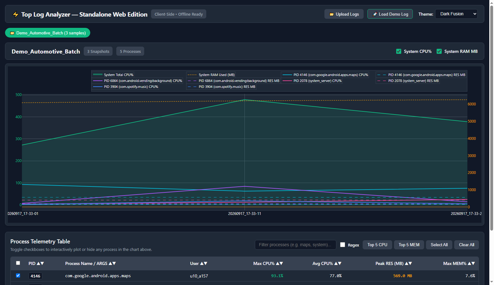
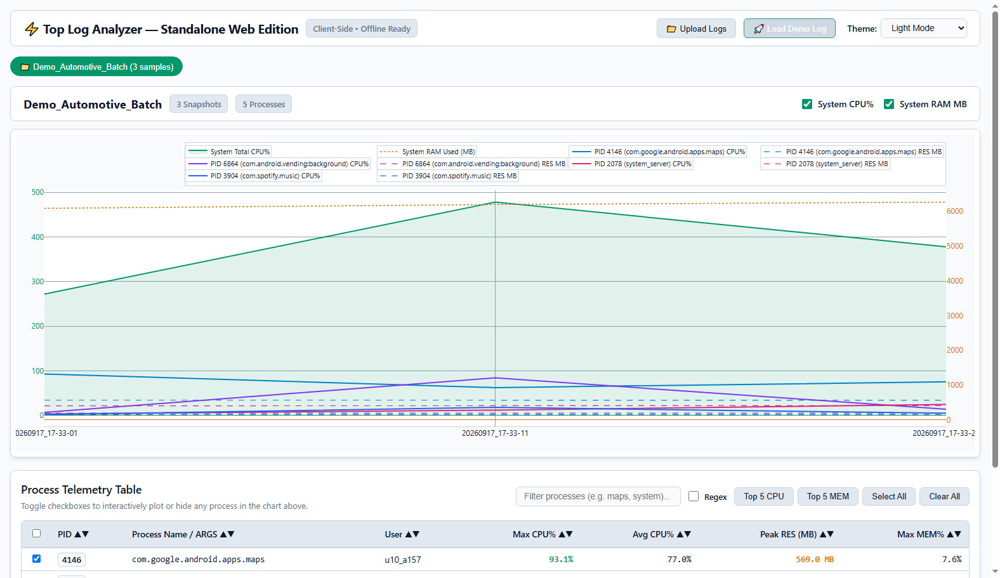
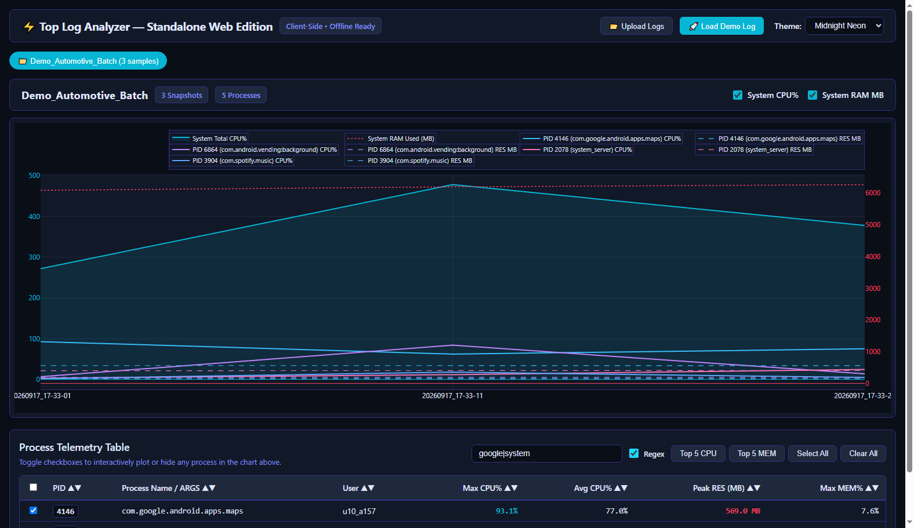

# ⚡ Top Log Analyzer — Standalone Web & Desktop Edition

[](https://CJ-1981.github.io/top-plot/)
[](https://github.com/CJ-1981/top-plot)
[](https://github.com/CJ-1981/top-plot)
[](https://plotly.com/)
[](https://github.com/CJ-1981/top-plot)
[](LICENSE)

An advanced, zero-dependency, single-file telemetry analyzer for Linux, Android, and automotive embedded system `top` and `/proc/meminfo` logs (Current Release: **v2.3.2**, Build: `2026-10-29`). 

Available both as a **100% offline standalone web application** (running entirely client-side inside your browser with zero server and zero network requests) and as a **rich native Qt desktop application**.

---

## 🌐 Live Demo & Instant Access

👉 **[Launch Top Log Analyzer Web Edition](https://CJ-1981.github.io/top-plot/)**

- **Instant 1-Click Demo**: Click **"🚀 Load Demo Log"** to immediately explore an interactive automotive telemetry dataset.
- **Air-Gapped & Offline Ready**: Download [`top_log_analyzer_standalone.html`](top_log_analyzer_standalone.html) or [`index.html`](index.html), copy it to a USB drive or isolated test bench, and double-click to open in Chrome, Edge, Firefox, or Safari.

---

## 📸 Screenshots

### Dark Fusion Theme


### Light Mode Theme


### Interactive Regex Filtering & Process Telemetry Table


---

## 🚀 Key Features

### 1. 📂 Intelligent Multi-File Drop & Virtual Path Isolation
- **Automotive Log Pairing**: Automatically identifies and merges paired `log_top@<timestamp>` (CPU metrics) and `log_topmen@<timestamp>` (Memory metrics) into a unified timeline.
- **Parent Folder Disambiguation**: When dropping directory hierarchies (e.g. `Run_01/log_top...` and `Run_02/log_top...`), relative paths via `webkitRelativePath` ensure logs with identical filenames are never mixed or overwritten.
- **Multi-Drop Virtual Paths**: Dropping repeated batches with identical names automatically partitions files into isolated virtual containers (`Drop 1/`, `Drop 2/`, ...).
- **Inline Session Renaming (✏️)**: Click the rename icon next to any active session pill to quickly customize session labels on the fly.
- **Individual Session Removal (✕)**: Remove specific sessions directly from their pills without disrupting or reloading remaining datasets.
- **Workspace Clear All (🗑️ Clear All)**: Reset the workspace, clear all loaded sessions, purge plots, and return to the upload zone with a single click.
- **Global Drag & Drop Zone**: Drop single files, multiple selections, or entire folders anywhere on the window.

### 2. ⚡ Batch Export All (Web & Desktop)
Export all loaded sessions simultaneously in one seamless operation:
- **Desktop Application (PyQt6)**:
  - Generates comprehensive datasets: CSV metrics, structured JSON, 150 DPI high-resolution PNG charts, and standalone interactive HTML reports.
  - Flexibility to save exports **next to the original log files** or export all sessions into a **custom selected directory**.
- **Standalone Web Edition**:
  - **Direct Folder Export (HTML5 File System Access API)**: On supported browsers (Chrome, Edge), select an export folder once to stream all CSV, JSON, PNG, and HTML reports directly to disk without individual download prompts.
  - **Zero-Dependency ZIP Archive**: For Firefox, Safari, or restricted environments, bundles all session telemetry reports into a single `.zip` file using a 100% pure vanilla JavaScript deflate/store engine and custom CRC-32 checksum calculation.

### 3. 📈 Interactive Dual Y-Axis Telemetry & System Analytics
- **Dual Y-Axes**: Synchronized visualization of CPU Usage (`%`) on the primary left axis and Physical Memory (`RES MB`) on the secondary right axis.
- **System CPU Breakdown**: Detailed system-level CPU traces including User (`usr`), System (`sys`), IO Wait (`io`), Nice (`nic`), and IRQ (`irq`).
- **Swap & Shared Memory Tracking**: Trace process swap usage (`SWAP MB`) and shared memory (`SHR MB`) alongside Resident (`RES`) and Virtual (`VIRT`) allocations.
- **`/proc/meminfo` System Memory Alignment**: Tracks system-wide memory pressure, correlating `MemTotal`, `MemFree`, `MemAvailable`, `Buffers`, `Cached`, and `SReclaimable`.
- **Uncapped Hover Cards**: Full, untruncated process arguments and package names with instant metric readouts and cursor crosshairs.
- **Timeline RangeSlider & Height Resizer**: Pan and zoom smoothly across hours of high-frequency log samples with mini-overview maps, plus an interactive vertical drag handle to freely adjust plot height from 300px to 1800px.
- **Marker Inspection & Hover Menus**: Hover over any marker tag to display an instant telemetry card showing CPU breakdown, RAM, Swap, and top offending processes, with quick 1-click **Edit**, **Drilldown**, and **Delete** actions.
- **Interactive Annotations & Zooming (Web & Desktop)**: Click or double-click to add annotations, use the mouse scroll wheel for bidirectional time-range zooming, and maintain clean dual-axis alignment across theme switches.

### 4. 🔬 Point-in-Time Process Snapshot Drilldown
- Click any point on the telemetry timeline to open a modal inspection window detailing the exact system state at that microsecond:
  - Overall system CPU state and memory saturation.
  - Complete process table with instant regex search and CSV export for that specific snapshot.

### 5. 🎨 5 High-Contrast Color Themes
Switch dynamically between curated, WCAG-compliant color palettes with perfect SVG contrast:
- 🌌 **Dark Fusion** (Default deep slate & vibrant emerald/amber)
- ☀️ **Light Mode** (Crisp paper white with deep jewel curves)
- 🌆 **Midnight Neon** (Vibrant cyber neon on obsidian)
- 🌲 **Solarized Dark** (Precision palette for extended analysis)
- 🎨 **Monokai** (Classic developer theme with neon accents)

### 6. 🗃️ Process Control & Filter Table
- **Numeric Column Sorting**: Sort by PID, Max CPU%, Avg CPU%, Peak RES (MB), Max SHR (MB), and Max MEM%.
- **Regex & Free-Text Filter**: Instantly isolate processes with standard text queries or full regular expressions (`google|system|mediaserver`).
- **Batch Action Buttons**: Instant presets for **Top 5 CPU**, **Top 5 MEM**, **Select All**, and **Clear All**.
- **PID Trace Visibility Toggles (CPU / MEM)**: Dedicated toggle buttons (`[x] PID CPU` and `[x] PID MEM`) allow toggling all process CPU lines or memory lines on or off simultaneously without unchecking processes in the table—keeping plots clean and focused when analyzing system-wide aggregates or specific resources.
- **Stacked Area Mode (📊 Area Chart)**: Toggle between individual line traces and stacked area charts across CPU breakdown (`%user`, `%sys`, `%nice`, `%irq`, etc.), process CPU utilization (`pid_cpu_stack`), process RAM allocations (`pid_mem_stack` on secondary axis), and system RAM—offering clear visibility into cumulative workload and memory footprint without visual clutter.

### 7. 🛡️ Toybox Hypervisor & Steal Overflow Correction (%host & Phantom Idle)
- **Virtualization & %host Accounting**: Embedded automotive Android systems running on top of hypervisors (e.g. QNX, ACRN, Gunyah) report hypervisor steal time via `%host` in Toybox `top`.
- **Toybox Phantom Idle Overflow Mitigation**:
  In Android's Toybox `top` source code (`toys/posix/ps.c`), idle time is computed as `stats[3] = now - llabs(ll)` where `ll` is the sum of active tick deltas. When hypervisor steal (`%host`) or scheduling burst causes active ticks to momentarily exceed capacity (e.g. $847\% > 800\%$), Toybox calculates a negative delta ($800 - 847 = -47$) and invokes `llabs(-47)`, incorrectly reporting $+46\%$ idle despite the system being 100% saturated.
- **Architectural Normalization Decision**:
  - When $\sum \text{active} \ge \text{capacity}$: The analyzer detects the Toybox overflow artifact, corrects idle to `0.0%`, bounds `System Total CPU%` to physical system capacity ($800.0\%$), and proportionately normalizes breakdown layers to $800.0\%$.
  - This ensures that:
    1. The stacked area chart ceiling never exceeds physical CPU capacity ($800\%$).
    2. The stacked area breakdown aligns 1:1 with the `System Total CPU%` line with zero visual gap or overflow.
    3. Naive calculations (`capacity - idle = 754%`) that subtract phantom idle are corrected to true saturated capacity ($800\%$).

### 8. 🎯 Intelligent Hover Menu Optimization (Zero-Noise, Ranked Telemetry & Scroller)
- **System Metrics Pinned to Top**: When enabled, `System Total CPU%`, `System RAM Used (MB)`, `System Swap Used (MB)`, and individual `CPU Breakdown` layers (`%user`, `%sys`, `%nice`, `%irq`, etc.) are always prioritized at the very top of the unified hover card.
- **Two-Tier Ranked Ordering**: Active process traces are dynamically sorted in real time at every hovered timestamp:
  1. **Process CPU% traces** sorted in **descending order** (highest CPU consumers at the top).
  2. **Process RAM traces** sorted in **descending order** (highest memory consumers at the top).
- **Zero-Value Suppression (Noise Reduction)**: Individual process traces with `0%` CPU or `0 MB` Memory are automatically hidden from the unified hover card (`display: none`), preventing dozens of dormant background threads (e.g. `sleep`, idle daemons) from stretching the hover card vertically across the entire viewport.
- **Dedicated Hover Menu Scroller**:
  - When the list of active processes exceeds the maximum visible height (capped at 320px or `plotHeight - 80px`), a sleek vertical SVG scrollbar is activated on the hover card.
  - Hovering over the card allows users to smoothly scroll through all active processes via mouse wheel or scrollbar drag, with canvas zoom propagation stopped (`stopPropagation`) so the timeline zoom level remains steady.
  - Moving the cursor to a new timestamp resets the hover scroll position back to the top, guaranteeing system totals and top consumers are always immediately in view.
- **Dynamic Box Sizing & Boundary Clamping**: The hover card background rectangle and clipping masks dynamically shrink to wrap only active metrics, and the entire hover box is clamped within the chart bounds so headers and readouts are never clipped at the screen edges.

### 9. 📐 Constrained PID Legend Area & Resizer Space Allocation
- **Max 5-Line Lock**: When many or all PIDs are selected (e.g., 50+ processes creating 15–30+ rows of legend items), the upper horizontal legend area is locked to a maximum of 5 lines in height (~100–115px).
- **Dedicated Legend Scrollbar & Mouse Wheel Scroll**:
  - Traces beyond 5 lines remain fully accessible via an integrated SVG scrollbar and smooth mouse-wheel scrolling.
  - Mouse-wheel events over the legend box prevent canvas zoom propagation (`stopPropagation`), ensuring plot zoom is unaffected while scrolling through legend items.
- **Zero Empty Top Margin Void**: Employs container-referenced legend coordinate anchoring (`yref: "container"`, `yanchor: "top"`) paired with explicit `autoexpand: false` margin management and synchronized `_reservedMargin` tracking. This completely eliminates Plotly's default multi-hundred-pixel empty top void between the horizontal legend and plot curves, preventing dead margin space from ballooning when dragging the vertical resizer down.
- **Dedicated Height Allocation on Drag**: When expanding chart height using the vertical resize handle (`#plotResizeHandle` from 300px to 1800px), the legend height remains locked at 5 lines, dedicating 100% of the gained vertical pixels directly to enlarging the telemetry curves and stacked area charts.
- **Automatic Dynamic Unlock**: When 5 or fewer lines are active (e.g., default view, "Top 5 CPU", "Top 5 MEM", or "Clear All"), the legend automatically unlocks to its natural height, dynamically contracts the top margin to ~35px, and hides the scrollbar.

---

## 📁 Repository Structure

```
├── index.html                        # GitHub Pages entry point (self-contained app)
├── top_log_analyzer_standalone.html  # Standalone single-file HTML distributable
├── docs/
│   └── images/                       # Screenshots and visual assets
├── README.md                         # Documentation
└── LICENSE                           # MIT License
```

---

## 📄 Supported Log Formats

- **Automotive Paired Logs**: `log_top@...` and `log_topmen@...` pairs (parsed and aligned automatically)
- **Standard Linux `top`**: `top -b` snapshot logs
- **Android `top`**: Output from `adb shell top -b -d 1`
- **Linux `/proc/meminfo`**: Periodic memory dumps matched to timeline timestamps

---

## 📄 License

This project is licensed under the [MIT License](LICENSE).
